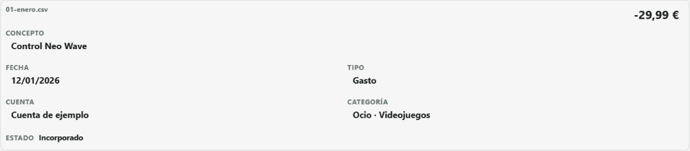
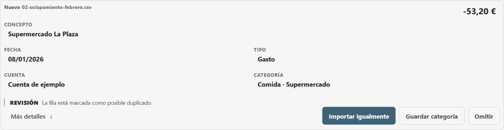
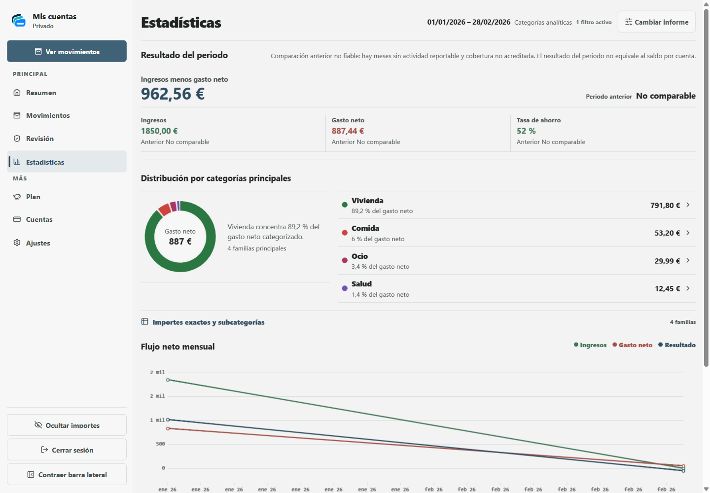

# APP de mis cuentas

App personal y autoalojada para dejar de mantener manualmente las finanzas en
una hoja de cálculo. Cada instalación es para una persona y sus datos permanecen
en su propio equipo.

Puedes importar movimientos desde CSV, clasificarlos con reglas, revisar los
pendientes, consultar estadísticas y exportarlos a Excel. No necesitas conectar
una cuenta bancaria para probar el flujo de CSV.

La licencia del código es [MIT](LICENSE).

## Empezar

Sigue la [guía para instalar la app en tu equipo con Docker](docs/self-hosted-quickstart.md).
El acceso inicial queda limitado a localhost y usa datos locales.

Requisitos de ejecución: Docker Desktop con Docker Compose v2 en Windows,
macOS o Linux. Para desarrollo desde el código fuente, usa Python 3.13 y Node
20.19.5, tal como indican `.python-version` y `.node-version`.

## Probar el recorrido con CSV

El ejemplo usa datos ficticios, no necesita conectar un banco y parte de una
instancia vacía. El perfil **CSV genérico** espera las columnas
`date,description,amount,category,subcategory`, fechas `AAAA-MM-DD`, gastos con
importe negativo e ingresos con importe positivo.

1. En **Cuentas**, añade una cuenta corriente llamada `Cuenta de ejemplo` con
   saldo inicial `0`.
2. En **Revisión → Importar CSV**, elige esa cuenta y **CSV genérico**. Sube
   [`01-enero.csv`](examples/csv/01-enero.csv).
3. En la fila `Control Neo Wave`, cambia `Compras personales · Tecnología` por
   `Ocio · Videojuegos`, guarda la categoría y pulsa **Confirmar lote seguro**.
4. Sube [`02-solapamiento-febrero.csv`](examples/csv/02-solapamiento-febrero.csv).
   La compra de `Supermercado La Plaza` se reconoce como duplicada. Pulsa
   **Omitir** en esa fila y después **Confirmar lote seguro** para las dos
   filas nuevas.
5. En **Movimientos** aparecen seis movimientos. En **Estadísticas**, abre
   **Cambiar informe → Personalizado**, indica `01/01/2026` y `28/02/2026` y
   pulsa **Aplicar rango**: ingresos `1.850,00 €`, gasto neto `887,44 €` y
   resultado `962,56 €`.
6. En **Ajustes → Datos y recuperación**, pulsa **Descargar Excel**. El archivo
   del ejemplo contiene esos seis movimientos.

La comparación con el periodo anterior aparecerá como no comparable porque la
instancia de ejemplo solo tiene datos de enero y febrero. Los meses sin datos no
demuestran que el gasto haya sido cero.

## Desarrollo

Instala los requisitos fijados con `python scripts/bootstrap.py`. Para ejecutar
las pruebas backend usa `python manage.py test`; desde `frontend-react/`, ejecuta
`npm test` y `npm run build`. Las versiones requeridas son Python 3.13 y Node
20.19.5.

## Datos, alcance y límites

La aplicación está pensada para una persona en un equipo que administra. La
base de datos y los adjuntos permanecen en `self-hosted-data`; las copias
locales se guardan en `self-hosted-backups`. El archivo `.env` contiene una
clave propia de la instalación y no se incluye en las copias. Guarda una copia
en otro dispositivo y sigue la guía de
[copia, restauración y actualización](docs/self-hosted-recovery.md).

El MVP cubre cuentas manuales, importación CSV, revisión de movimientos,
estadísticas y exportación a Excel. No ofrece cuentas multiusuario, alojamiento
gestionado ni sincronización en la nube. La conexión bancaria no está habilitada
ni soportada por el Compose público; requiere configuración, credenciales,
consentimiento y callback HTTPS propios, y está sujeta a las condiciones del
proveedor. Consulta la [decisión de alcance bancario](docs/analysis/OSS_BANK_CONNECTION_DECISION_2026-11-19.md).
No publiques esta instalación en Internet con la configuración local.

## Versiones y soporte

La primera versión estable aún no se ha publicado, así que todavía no hay una
versión estable oficialmente soportada. Cuando haya una release, se dará soporte
a la última versión estable publicada. El proyecto es personal y no ofrece un
SLA ni soporte profesional.

## Licencia, autoría y colaboración

El código se publica bajo la [licencia MIT](LICENSE). Autor y mantenedor:
[Alejandro Regidor Orellana](https://github.com/alexregii). Es un proyecto
personal, no un servicio de asesoría financiera ni una entidad bancaria.

El alcance de la primera candidata y sus limitaciones están en
[RELEASE_NOTES.md](RELEASE_NOTES.md). Los recursos visuales y las dependencias
se describen en [THIRD_PARTY_NOTICES.md](THIRD_PARTY_NOTICES.md).

Se aceptan informes de errores y propuestas de cambio mediante las pestañas
**Issues** y **Pull requests** del repositorio donde se publique este proyecto.
Incluye pasos reproducibles y datos inventados. Nunca adjuntes extractos,
exportaciones, copias de la base de datos, archivos `.env`, claves ni otros datos
financieros reales. Lee [SECURITY.md](SECURITY.md) antes de informar de una
vulnerabilidad.
