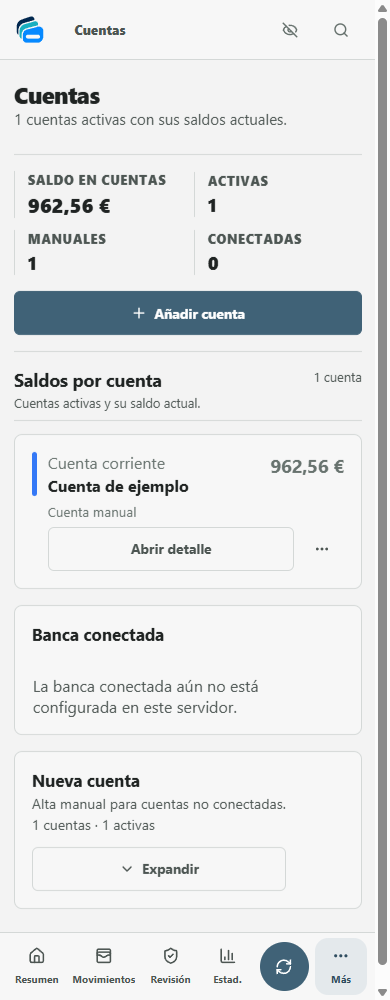

<div align="center">
  
  <h1>APP de mis cuentas</h1>
  <p><strong>Deja de llevar tus finanzas a mano en Excel.</strong></p>
  <p>Importa CSV. Revisa los movimientos. Exporta a Excel.<br />Los datos se quedan en tu equipo.</p>
  <p>
    <a href="https://github.com/alexregii/app-de-mis-cuentas-oss/releases/latest">Última release</a>
    &nbsp;·&nbsp; <a href="LICENSE">Licencia MIT</a>
    &nbsp;·&nbsp; Autoalojada
  </p>
</div>

<p align="center">
  
</p>

## Para quien ya usa una hoja de cálculo

APP de mis cuentas quita trabajo manual al importar y revisar movimientos. No
intenta ser una plataforma bancaria ni un servicio en la nube: es una
instalación personal que administras en tu propio equipo.

| Importa | Revisa | Entiende | Exporta |
| --- | --- | --- | --- |
| Movimientos CSV | Categorías y duplicados antes de confirmar | Estadísticas con límites claros | Un Excel con tus movimientos |

## También está cuidada para móvil

La navegación inferior y las tarjetas se reorganizan para una pantalla
estrecha. Esta captura es un viewport móvil de 390×1000, no una página completa;
la cuenta y el saldo son sintéticos:

<p align="center">
  
</p>

## Pruébala con datos ficticios

El repositorio incluye dos CSV de ejemplo para recorrer el flujo completo:

1. Crea una cuenta corriente llamada `Cuenta de ejemplo` con saldo inicial `0`.
2. En **Revisión → Importar CSV**, usa **CSV genérico** y sube
   [`01-enero.csv`](examples/csv/01-enero.csv).
3. En `Control Neo Wave`, cambia `Compras personales · Tecnología` por
   `Ocio · Videojuegos` y confirma el lote seguro.
4. Sube [`02-solapamiento-febrero.csv`](examples/csv/02-solapamiento-febrero.csv).
   Omite la compra duplicada de `Supermercado La Plaza` y confirma las dos filas
   nuevas.
5. Verás seis movimientos. En **Estadísticas**, selecciona el periodo
   personalizado del 01/01/2026 al 28/02/2026: ingresos `1.850,00 €`, gasto neto
   `887,44 €` y resultado `962,56 €`.
6. En **Ajustes → Datos y recuperación**, descarga el Excel del ejemplo.

Los meses sin datos aparecen como no comparables; no se interpretan como gasto
cero.

## Instálala en tu equipo

Necesitas Docker Desktop con Docker Compose v2 y Python solo para crear la clave
local; la aplicación se ejecuta en contenedores. La guía explica el primer
usuario y cubre Windows, macOS y Linux:

**[Guía de instalación rápida](docs/self-hosted-quickstart.md)**

En resumen, el flujo es:

```sh
git clone https://github.com/alexregii/app-de-mis-cuentas-oss.git
cd app-de-mis-cuentas-oss
python scripts/init_self_hosted_env.py
docker compose -f compose.yml up --build -d web react-web backup
docker compose -f compose.yml ps
docker compose -f compose.yml exec web python manage.py createsuperuser
```

El comando inicial `python` puede llamarse `python3` en macOS o Linux. El helper
crea `.env` con una clave aleatoria y se niega a sobrescribir una configuración
existente. No muestra la clave. No hay un usuario ni una contraseña
predeterminados.

## Datos y límites

- Una instalación es para una persona. No hay registro público ni cuentas
  multiusuario.
- SQLite, adjuntos y copias permanecen en `self-hosted-data` y
  `self-hosted-backups`. Conserva ambos directorios y sigue la
  [guía de recuperación y actualización](docs/self-hosted-recovery.md).
- El Compose publica solo en `127.0.0.1`. No lo expongas a Internet ni a la red
  local.
- La conexión bancaria está desactivada y fuera de soporte. La licencia MIT no
  concede acceso a APIs bancarias.
- La release no distribuye imágenes OCI; Compose construye las imágenes en tu
  equipo.

## Agentes de código

El repositorio incluye instrucciones para OpenAI Codex, Cursor, Claude Code,
Gemini CLI y GitHub Copilot. `AGENTS.md` es la guía común; `CLAUDE.md`,
`GEMINI.md` y `.github/copilot-instructions.md` enlazan con ella. Para instalar,
el agente debe seguir la guía rápida, usar datos sintéticos y no exponer el
servicio.

## Desarrollo, seguridad y soporte

Para preparar dependencias de desarrollo, ejecuta `python scripts/bootstrap.py`.
Las pruebas backend se ejecutan con `python manage.py test`; desde
`frontend-react/`, usa `npm test` y `npm run build`. Las versiones están fijadas
en `.python-version`, `.node-version` y los lockfiles.

El soporte se limita a la última release estable. Consulta
[RELEASE_NOTES.md](RELEASE_NOTES.md) para el alcance publicado y
[SECURITY.md](SECURITY.md) para informar vulnerabilidades en privado. No adjuntes
extractos, bases de datos, `.env`, contraseñas ni datos financieros reales a un
Issue o Pull Request.

## Licencia y autoría

MIT. Autor y mantenedor: [Alejandro Regidor Orellana](https://github.com/alexregii).
Proyecto personal; no ofrece asesoría financiera ni servicios bancarios.
